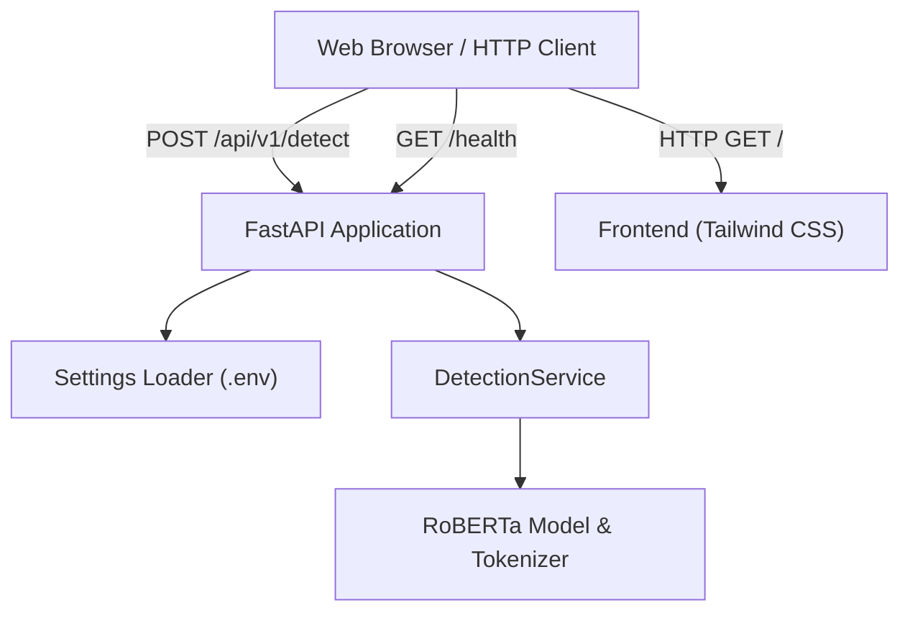

# AI Text Detection Engine (ATD)

An enterprise-ready AI text classification service and web interface powered by **FastAPI**, **PyTorch**, and a fine-tuned **RoBERTa** transformer model (`RobertaForSequenceClassification`).

[](https://github.com/ClayMichael2004/ATD/actions)
[](LICENSE)
[](https://www.python.org/)
[](https://fastapi.tiangolo.com/)

---

## Architecture Overview



---

## Features

- **Fine-Tuned RoBERTa Classifier:** Accurately distinguishes between AI-generated and human-written content.
- **RESTful API:** Validated input/output with Pydantic schemas, detailed confidence ratings, and class probability breakdowns.
- **Interactive Web Interface:** Clean UI built with Tailwind CSS, live character/word counters, and pre-loaded sample presets.
- **12-Factor Configuration:** All application and model parameters managed cleanly via `.env` environment variables.
- **Container Ready:** Multi-stage, production-hardened `Dockerfile` with non-root security context and `docker-compose.yml`.
- **Automated Testing & CI:** Complete unit and integration test suite with `pytest` and GitHub Actions pipeline.

---

## Project Structure

```
ATD/
├── app/
│   ├── __init__.py           # Application package metadata
│   ├── api/
│   │   ├── __init__.py
│   │   └── endpoints.py      # /api/v1/detect route handler
│   ├── config.py             # Centralized settings & .env loader
│   ├── main.py               # FastAPI application lifecycle & middleware
│   ├── schemas.py            # Pydantic request and response models
│   └── services/
│       ├── __init__.py
│       └── detector.py       # Inference engine and tokenizer management
├── frontend/
│   └── index.html            # Single-page web user interface
├── saved_ai_detector/
│   ├── README.md             # Model metadata and setup guide
│   ├── config.json           # Hugging Face model architecture config
│   ├── tokenizer.json        # Tokenizer vocabulary and byte BPE
│   └── tokenizer_config.json # Tokenizer special tokens and padding
├── scripts/
│   └── run_dev.sh            # Development startup helper script
├── tests/
│   ├── conftest.py           # Pytest test client fixtures
│   ├── test_api.py           # Integration tests for API routes
│   ├── test_config.py        # Settings and environment variable tests
│   └── test_schemas.py       # Schema validation unit tests
├── .dockerignore             # Docker build exclusions
├── .env.example              # Environment variables template
├── .gitignore                # Git exclusions (venv, .env, model weights)
├── Dockerfile                # Production container specification
├── docker-compose.yml        # Docker service orchestration
├── Makefile                  # Developer workflow targets
├── requirements.txt          # Production dependencies
├── requirements-dev.txt      # Development & testing dependencies
├── CONTRIBUTING.md           # Contribution guidelines
├── LICENSE                   # MIT License
└── README.md                 # Project documentation
```

---

## Quickstart Guide

### 1. Clone the Repository

```bash
git clone https://github.com/ClayMichael2004/ATD.git
cd ATD
```

### 2. Environment & Dependency Setup

Create a virtual environment and install dependencies:

```bash
python3 -m venv venv
source venv/bin/activate
pip install -r requirements-dev.txt
```

### 3. Configure Environment Variables

Copy `.env.example` to `.env`:

```bash
cp .env.example .env
```

Available configuration options in `.env`:

| Variable | Default | Description |
|----------|---------|-------------|
| `APP_NAME` | `AI Text Detection Engine` | Application display name |
| `APP_ENV` | `development` | Runtime environment (`development`, `production`) |
| `HOST` | `0.0.0.0` | Server listen address |
| `PORT` | `8000` | Server port |
| `MODEL_PATH` | `./saved_ai_detector` | Directory containing model configuration and weights |
| `MAX_SEQUENCE_LENGTH` | `512` | Maximum token sequence length |
| `DEVICE` | `auto` | Execution device: `auto`, `cuda`, or `cpu` |
| `CORS_ORIGINS` | `*` | Comma-separated list of allowed origins |

### 4. Model Weights Placement

Place the fine-tuned weights file `model.safetensors` (~314 MB) into the `saved_ai_detector/` directory:

```
saved_ai_detector/
├── config.json
├── model.safetensors   <-- Place weights file here
├── tokenizer.json
└── tokenizer_config.json
```

> **Note on Git Hygiene:** Following standard engineering practices, `model.safetensors` and virtual environment folders (`venv/`) are excluded from Git tracking via `.gitignore`.

### 5. Run the Application

Start the development server with hot-reload:

```bash
# Using Makefile
make run

# Or directly using uvicorn
uvicorn app.main:app --host 0.0.0.0 --port 8000 --reload
```

Open your browser at **[http://localhost:8000](http://localhost:8000)** to access the web interface or **[http://localhost:8000/docs](http://localhost:8000/docs)** for interactive Swagger API documentation.

---

## API Reference

### Text Detection

- **Endpoint:** `POST /api/v1/detect`
- **Content-Type:** `application/json`

#### Request Body
```json
{
  "text": "Artificial intelligence has rapidly transformed natural language processing workflows."
}
```

#### Response Body
```json
{
  "verdict": "AI-Generated",
  "confidence": 98.42,
  "is_ai": true,
  "probabilities": {
    "human": 1.58,
    "ai": 98.42
  }
}
```

### Health Check

- **Endpoint:** `GET /health`

#### Response Body
```json
{
  "status": "healthy",
  "app": "AI Text Detection Engine",
  "version": "1.0.0",
  "device": "cpu",
  "model_loaded": true
}
```

---

## Testing

Run the automated test suite with `pytest`:

```bash
make test
# Or:
pytest -v tests/
```

---

## Docker Deployment

### Using Docker Compose

```bash
# Build and run container with local model mounted
docker compose up -d

# Stop container
docker compose down
```

### Standalone Docker Build

```bash
docker build -t atd-api:latest .
docker run -p 8000:8000 --env-file .env atd-api:latest
```

---

## License

This project is licensed under the [MIT License](LICENSE).
